# Ping Pong — Neon Edition

A browser ping pong game with five arenas that each play differently, a
build-your-own **Custom** mode with an arena editor (the **Forge**) and a ball
skin editor (**Ball Studio**), a computer opponent that plays shots on purpose
and talks trash, peer-to-peer **online play**, a ball physics engine written in
C++ and compiled to WebAssembly, GPU shader post-processing with up to 4K
scenery, and a level / XP / achievement system. It runs on PC, tablets and
phones, with keyboard, mouse, touch and gamepad.

### ▶ Play now: **https://lagilava.github.io/Ping-Pong-/**

No install and no account. Works in Chrome, Edge, Firefox and Safari on PC and
phone, and updates a minute or two after each push to `main`.

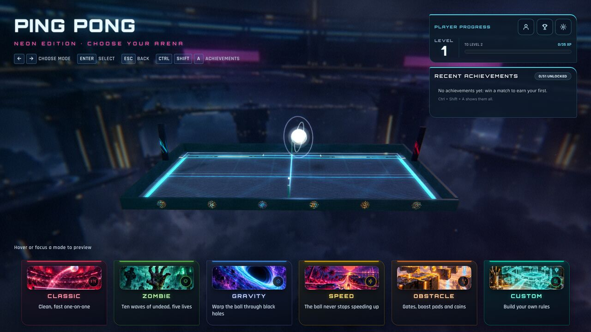

## Contents

- [The arenas](#the-arenas)
  - [Classic](#classic) · [Zombie](#zombie) · [Gravity](#gravity) · [Speed](#speed) · [Obstacle](#obstacle)
  - [Custom, the Forge and Ball Studio](#custom-the-forge-and-ball-studio)
- [Power-ups and the Laser Shot](#power-ups-and-the-laser-shot)
- [Arena abilities](#arena-abilities)
- [The computer opponent](#the-computer-opponent)
- [Play online with a friend](#play-online-with-a-friend)
- [Controls](#controls) (keyboard, mouse, gamepad, phones)
- [Settings](#settings) (visual quality, Noir, paddle designs, accessibility)
- [Progress and achievements](#progress-and-achievements)
- [How it plays: the physics](#how-it-plays-the-physics)
- [Graphics and performance](#graphics-and-performance)
- [Run it locally](#run-it-locally)
- [Project layout](#project-layout)
- [Tests](#tests) · [Rebuilding the physics engine](#rebuilding-the-physics-engine) · [Further docs](#further-docs)

## The arenas

Pick a mode on the main menu, then choose your opponent: **vs Computer** (one
player), **Local 1v1** (two players, one screen) or **Online** (a friend on
another device, with a room code). Every mode has a short match intro, a
first-time rules card, and a results card with XP at the end.

<p align="center">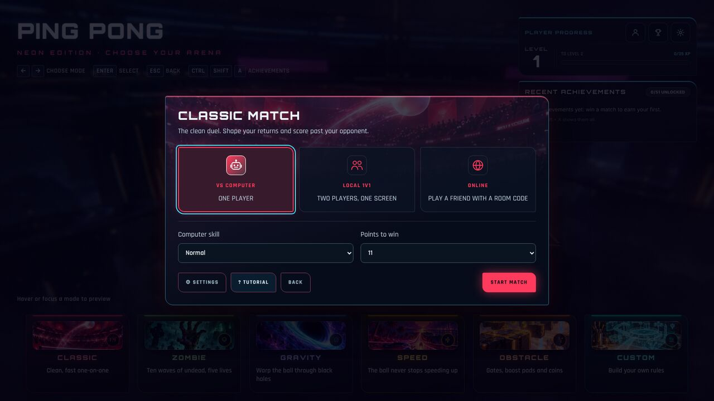</p>

| Mode | In one line |
|---|---|
| **Classic** | The straight duel: fast, clean, no gimmicks. |
| **Zombie** | Hold the line for ten waves of undead with five lives; wave 10 is the boss fight. |
| **Gravity** | Black holes bend the ball. Warp it through one with the Wormhole and the point is worth more. |
| **Speed** | The ball never stops speeding up, and reaction challenges interrupt the rally. |
| **Obstacle** | Moving gates, boost pads, ? blocks, coins and a Lucky Dice on a floating sunset citadel. |
| **Custom** | Your own arena, rules, paddles, ball, music, background and power-ups. |

### Classic

The clean one-on-one in a neon ping pong stadium: animated cloth banners and
crowd, string lights, spotlights and an LED ad board along the court. First to
the points you picked (5, 7, 11, 15 or 21) wins.

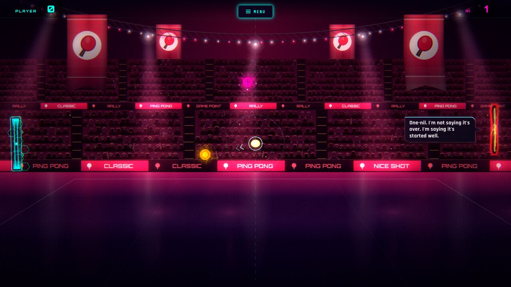

### Zombie

A survival run in a foggy graveyard. Smash every zombie on the court, or knock
out the wave's guardian, to clear a wave. You have five lives for the whole
run: the ball getting past you, or a zombie reaching your barricade, costs one.

- **Enemies:** shamblers, runners that lunge at the ball, spitters whose slime
  freezes your paddle, and tanks that take four hits. Each wave has a guardian
  to score past, and the difficulty rises every wave.
- **Undead Pull:** hold **Space** (gamepad **A**, right mouse button, a second
  finger, or the on-screen Pull button) and your paddle drags nearby zombies to
  the barricade, where they are destroyed for points without costing a life.
  It runs on an energy bar that recharges when you let go.
- **Wave rewards:** between waves you pick a reward: Rage, Shield (blocks
  zombie attacks), Slow or an extra Life.
- **Wave 10 boss:** a horned magma demon paddle whose jaws slide out and prise
  open as it charges a fire breath across the court.

<table>
<tr>
<td width="50%">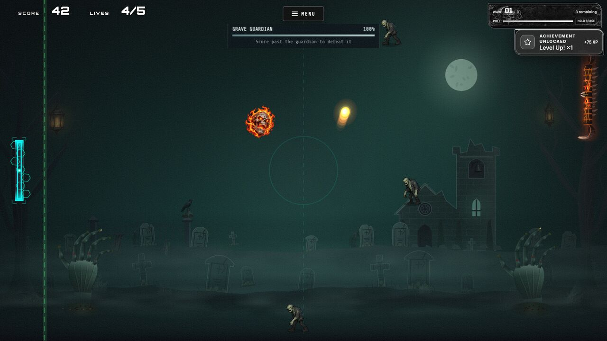<br/><sub><b>Zombie</b>: waves, lives, Pull energy and the wave guardian</sub></td>
<td width="50%">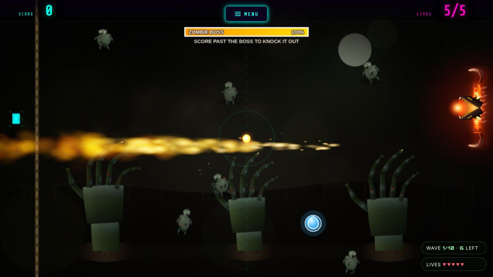<br/><sub><b>Wave 10</b>: the magma demon's fire breath</sub></td>
</tr>
</table>

### Gravity

A deep-space arena with animated nebulae, planets and black holes whose
accretion discs swirl and pull in material. The black holes bend the ball's
path, so shots curve around them.

The **Wormhole** ability (see [Arena abilities](#arena-abilities)) swallows the
ball as it passes a black hole and fires it out of another one, faster and
aimed at the opponent's goal. Each warp makes the point worth +1, up to 3.

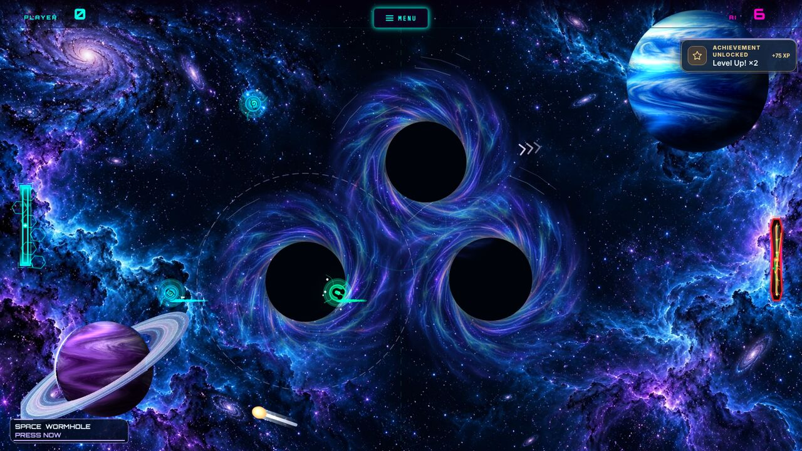

### Speed

A synthwave highway at sunset. The ball keeps accelerating through the rally,
and reaction challenges interrupt play: click the targets (or press the combo
in 1v1) before the timer runs out, with decoys mixed in as the levels climb.
**Overcharge** opens a short slow-motion parry window near your paddle and
fires a **Sonic Return** on contact.

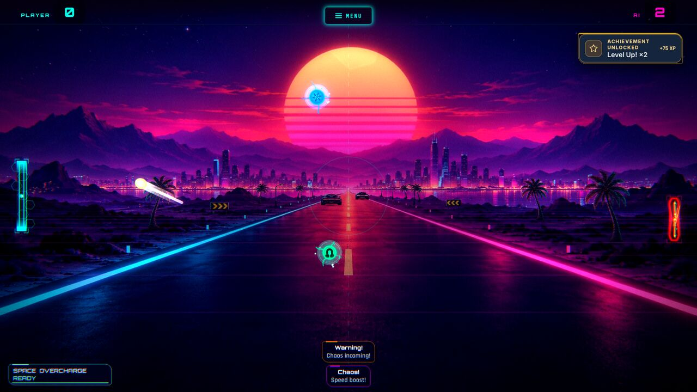

### Obstacle

Floating basalt-and-bronze platforms over violet sunset clouds, with energy
waterfalls pouring off the edges. The arena is 2.5x larger than the others,
revealed with a camera pull-out at the start. Moving gates and nodes carve up
the court, with a Rocket League and Mario twist:

- **Boost pads** launch the ball.
- **? blocks** pay out coins, Turbo or Star power.
- **Coins** arm a one-goal shield; extra coins bank for the next one.
- **Lucky Dice** (the arena ability) rolls a random power: 6 Star power,
  5 shooting balls, 4 pulls the ball to your paddle, 3 big paddle, 2 no luck,
  1 fast ball.
- Goals explode in confetti. The obstacles react to the ball and are drawn
  live, and the floor is a GPU shader.

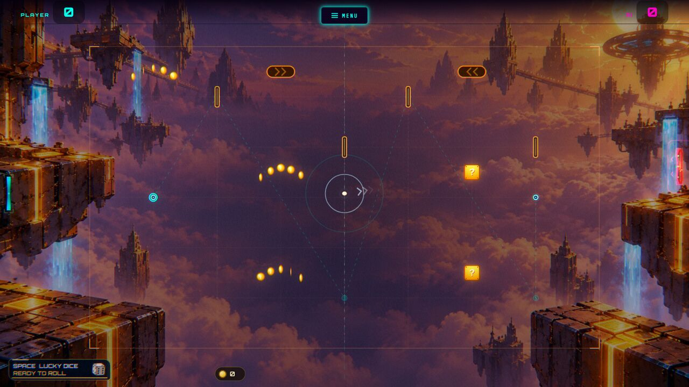

### Custom, the Forge and Ball Studio

**Custom** is local 1v1 (or online) on your own terms. The Custom screen has
five tabs: **Arena & rules**, **Paddles & ball**, **Music**, **Background** and
**Power-ups**. The live preview draws the selected arena and background exactly
as the match will.

- **Rules:** score to win, ball speed, rally speed-up, paddle size and arena
  gravity.
- **Paddles & ball:** a paddle design and colour for each side, plus your
  Ball Studio ball.
- **Music:** built-in tracks, a local audio file, a direct audio URL, or a
  YouTube, Spotify, SoundCloud or Apple Music link (**Play link**; the
  provider's player stays available in the match if the browser blocks
  autoplay).
- **Power-ups:** pick exactly which of the 16 power-ups can appear.

<table>
<tr>
<td width="50%">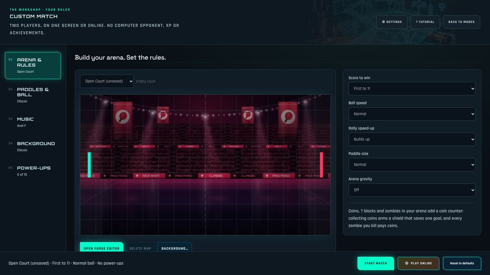<br/><sub><b>Custom</b>: arena preview and rules</sub></td>
<td width="50%">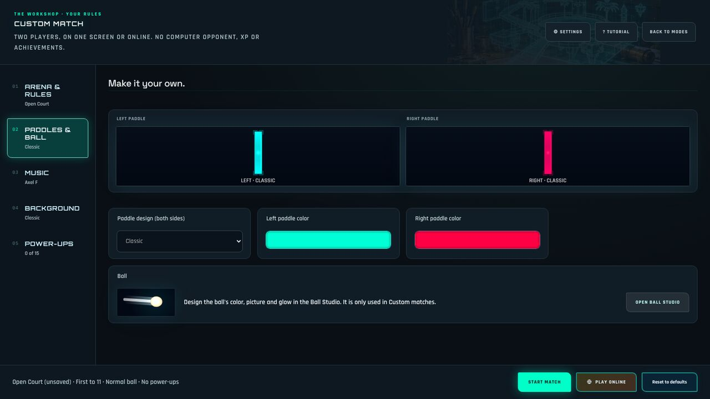<br/><sub><b>Paddles & ball</b>: designs, colours, Ball Studio</sub></td>
</tr>
</table>

**The Forge** is the arena editor. Place up to 32 objects from its library,
drag to move, scroll to resize, **R** to turn, with mirror and snap modes, an
object inspector, duplicate/delete and undo/redo (**Ctrl+Z / Ctrl+Y**). Save
maps and share them as codes.

| Object | What it does |
|---|---|
| Wall | Solid block. |
| Bumper | Round and bouncy. |
| Spinner | Rotating bar. |
| Moving gate | Slides up and down. |
| Deflector | Angled slab that turns the ball a right angle. |
| Laser gate | A beam that blocks the ball while lit, flickers, then switches off. |
| Crystal | Cracks on each hit, shatters on the third, then grows back. |
| Portal | Place two: the ball goes in one and out the other. |
| Black hole | Bends the ball; bigger pulls harder. |
| Boost pad | Launches the ball. |
| ? Block | Coins, Turbo or Star. |
| Coin | Collecting coins arms a one-goal shield. |
| Zombie | Shambler, runner, tank or spitter that blocks the ball and rises again. |

<table>
<tr>
<td width="50%">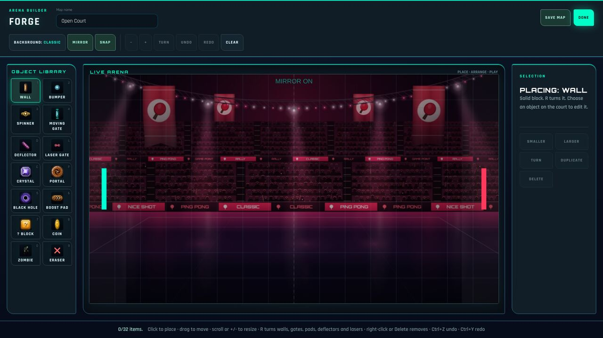<br/><sub><b>Forge</b>: object library, live arena, inspector</sub></td>
<td width="50%">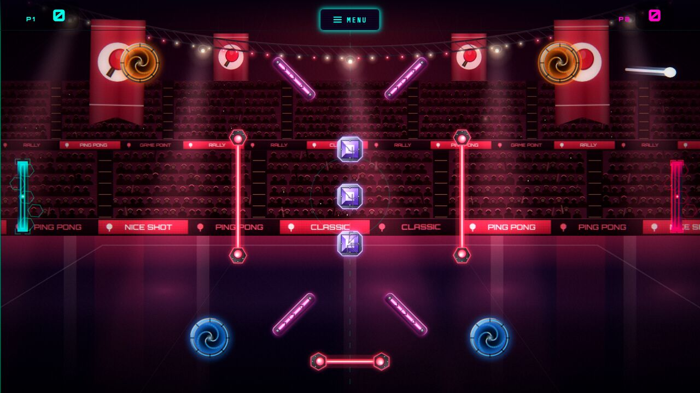<br/><sub>A Forge arena in play: deflectors, laser gates, crystals, portals</sub></td>
</tr>
</table>

**Custom backgrounds:** the Forge's **Background** button picks a built-in world
or imports an image or code. Imported backgrounds also appear on the Custom
screen. Code runs in a locked sandbox (no page access, storage or network), and
the import dialog has a ready-made prompt to paste into an AI assistant. Two
formats are accepted:

- **Canvas 2D JavaScript:** `function draw(ctx, w, h, t, game) { ... }`, called
  every frame. `game` has `ballX`, `ballY`, `speed`, `hit`, `goal`,
  `scoreLeft`, `scoreRight`. Optional `setup(ctx, w, h)`.
- **GLSL shader, Shadertoy style:** `void mainImage(out vec4 fragColor, in vec2
  fragCoord)` with `iResolution`, `iTime`, `iBall`, `iSpeed`, `iHit`, `iGoal`,
  `iScore`, `iMouse`. No textures.

**Ball Studio** ([`game/ball-studio.html`](game/ball-studio.html)) designs your
Custom-match ball: ball, trail and glow colours, a picture layer with opacity,
zoom and blend mode, saved presets, and optional custom effect code. Its
preview uses the real in-match ball renderer, in close-up and at match size.

<p align="center">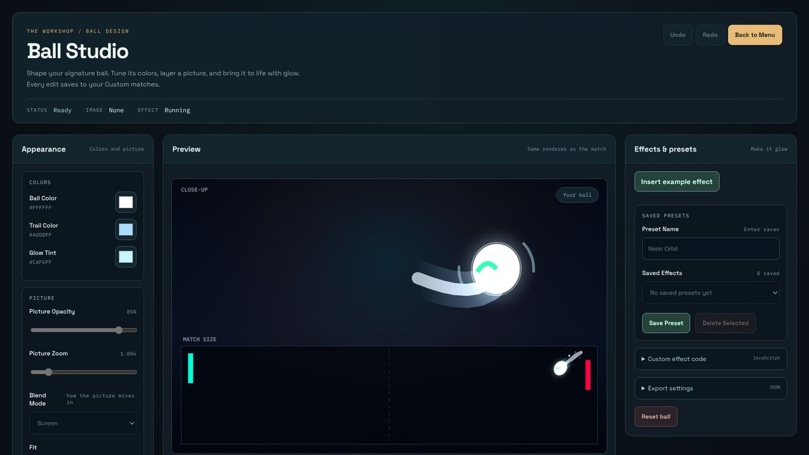</p>

## Power-ups and the Laser Shot

Power-ups float onto the court in Classic, Gravity, Speed and Obstacle (switch
them off in Settings > Gameplay) and in Custom (pick them on the Custom
screen). Hit one with the ball to collect it. Rarer ones move faster and glow
brighter.

| Rarity | Power-ups |
|---|---|
| Common | **Slow Ball**, **Fast Paddle**, **Small Ball**, **Double Points** |
| Uncommon | **Big Paddle**, **Magnet** (ball comes to you), **Ghost Ball** (passes through obstacles) |
| Rare | **Freeze** (opponent frozen), **Tiny** (shrinks paddles), **Power Shot** (next hit flies much faster) |
| Epic | **Invincible** (opponent can't score for 5 s), **Time Warp** (slow motion), **Laser Paddle**, **Shield** |
| Legendary | **Multi-Ball** (two extra balls), **Chaos Mode** |

Obstacle uses a short list (Slow Ball, Big Paddle, Power Shot, Time Warp,
Shield), and Speed leaves out Slow Ball and Time Warp.

**Laser Paddle** gives three **Laser Shots**: press **Space** (P2 **Enter**,
gamepad **A**, or a second finger on touch). Each paddle design charges up with
a capacitor spine and heat fins, fires with a muzzle flash, sends a prism lance
beam across the court and lands with impact rings (red for the left player,
cyan for the right). A hit stuns the other paddle. Reduce motion keeps the shot
readable without the ambient movement.

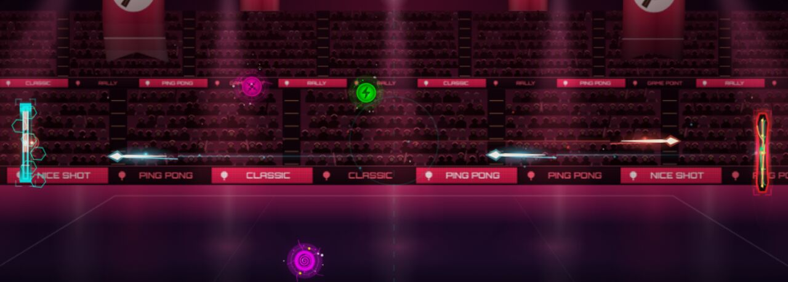

## Arena abilities

In local Speed, Gravity and Obstacle matches each player has an arena ability.
**Space** activates it (P2 **Enter**; gamepad **A**; mouse right-click; touch
a second finger or the on-screen button). The on-court label shows when it is
ready and when the ball is in range.

| Mode | Ability | Effect |
|---|---|---|
| Speed | **Overcharge** | Short slow-motion parry window near the paddle; contact fires a Sonic Return. |
| Gravity | **Wormhole** | Swallows the ball at a black hole and fires it out of another, aimed at the goal; +1 point per warp, up to 3. |
| Obstacle | **Lucky Dice** | Rolls one of six powers (see [Obstacle](#obstacle)). |
| Zombie | **Undead Pull** | Drags nearby zombies to the barricade (see [Zombie](#zombie)). |

Online matches use the standard mode rules without these active abilities.

## The computer opponent

The AI ([`game/js/ai/ai-opponent.js`](game/js/ai/ai-opponent.js)) predicts the
ball with the same C++ integrator as the game, so it reads curving shots.
Computer skill runs from **Rookie, Easy, Normal, Hard** to **Insane**, and
limits how far ahead it can see.

- It plays shots on purpose: picks where on its paddle to take the ball to aim
  away from you, fakes one angle and sweeps to the other, swipes for curve, and
  learns which side you miss on.
- Each match it has a style (corners, tricks, wall or bully) and changes plan
  when a tactic stops working. It eases off with a big lead.
- **Trash talk:** over 1,000 lines, per mode, style and level, that react to
  what you actually did: moving the wrong way, freezing, falling for a fake,
  edge hits, spin. Shown as speech bubbles (with an optional voice), and
  switchable in Settings > Gameplay.

## Play online with a friend

Pick **Online** in the opponent picker (or **Play Online** on the Custom
screen). One player chooses **Host** and gets an eight-character room code
(like `K7QM-2XPD`) plus an invite link; the other chooses **Join** and types
the code or opens the link. The host picks any mode (Classic, Zombie, Gravity,
Speed, Obstacle or Custom) and starts the match. On a phone, **Copy invite
link** opens the share sheet.

<p align="center">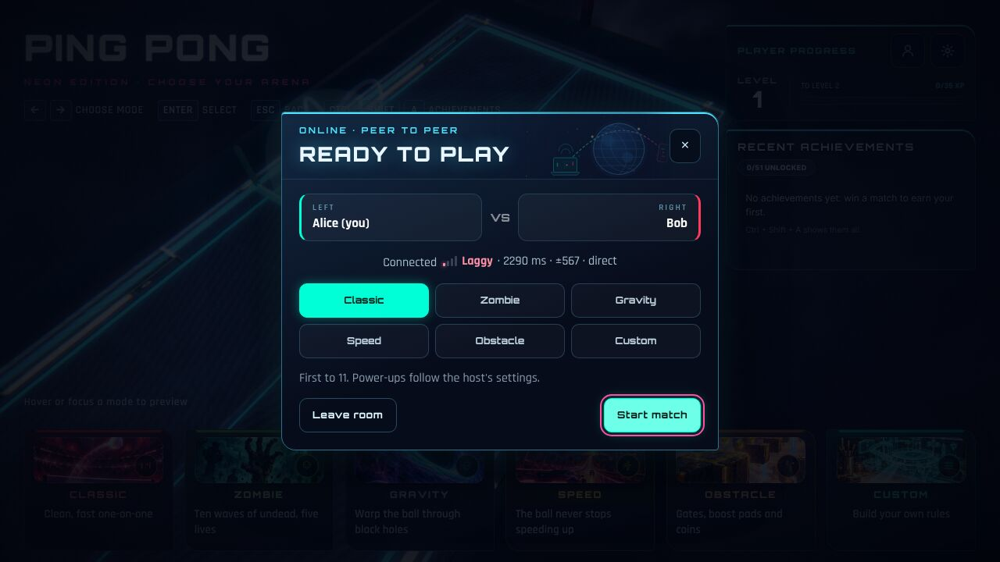</p>

- Peer to peer over WebRTC: the two browsers talk directly and there's no game
  server. To find each other, the handshake goes out through PeerJS's public
  broker and three public MQTT brokers at once (end-to-end encrypted), and the
  first copy wins, so one slow or blocked service doesn't stop a join.
- The host plays the left paddle, the guest the right; either can pause, and
  both press **Play again** for a rematch. **Change mode** takes both players
  back to the room. The lobby shows the series score.
- Each side shows the paddle design its own player picked.
- Online Zombie is a straight duel in the graveyard arena (the waves are a
  single-player thing).
- Players in different countries work too. The lobby shows connection quality
  (signal bars, ping, jitter, loss, and whether the link is direct or relayed),
  and the game adapts its prediction to the measured delay. On strict or mobile
  networks a free public TURN relay (Open Relay) carries the game; see
  [docs/online-play.md](docs/online-play.md) to add your own.
- If the connection drops, the match freezes and both sides reconnect for up
  to 60 seconds (Wi-Fi to mobile data included). Reloading puts you straight
  back in: a guest rejoins with the score intact, a host reopens the room on
  the same code. A third player who tries the code is told the room is full.
- Some school, office or mobile networks block peer-to-peer connections; the
  lobby says so and suggests another network (a phone hotspot often works).

## Controls

| Action | Keyboard / mouse | Gamepad | Touch |
|---|---|---|---|
| Move left paddle | **W / S**, or hold the mouse button and drag | Left stick or d-pad (analog) | Slide a thumb on the thumb pad (bottom right); a short slide crosses the court |
| Move right paddle (local 1v1) | **↑ / ↓** | Second pad | Drag on the right half |
| Laser / arena ability | **Space** (P2 **Enter**), right mouse button | **A** | Second finger or on-screen button |
| Pause | **Esc** | **Start** | Menu button |
| Performance readout | **F2** | | |

- **Main menu:** **← / →** (or d-pad / left stick) choose a mode, **Enter**
  (**A**) selects, **Esc** (**B**) backs out. The mode you played last says
  *Play again* and is where the selection starts. **Ctrl+Shift+A** opens the
  achievements.
- **Intros** always play, and **Esc** (or **Skip intro**) closes them. After
  the first match, match intros are short.
- Keys can be rebound for both players in Settings > Controls. Controllers
  rumble on hits and goals.

**Phones and tablets:** add the game to your Home Screen (on iPhone: Share,
then Add to Home Screen; the menu shows a one-time tip) and it opens full
screen in landscape with its own icon. Play in landscape (the match pauses if you turn the
phone upright; Android goes fullscreen and locks landscape when a match
starts). You steer with one thumb on the **thumb pad**, a small marked strip
in the bottom-right corner: your paddle follows the thumb's movement, and a
slide the height of the pad moves it across the whole court, so the thumb
rests in the corner instead of sweeping over the play. Touches elsewhere on
the screen still steer the same way. **Settings > Controls > Touch layout**
moves and resizes the pad and the ability button (drag them, pick one and set
its size, or *Swap sides* for left-handed play); a smaller pad means a faster
paddle. Abilities have on-screen buttons, there are touch tutorials
on the first match, and instant replays never interrupt a match: after a great
point a **▶ REPLAY** chip shows for a few seconds.

<p align="center">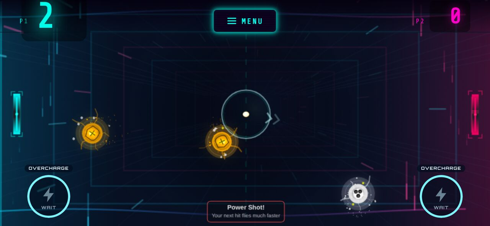</p>

<p align="center">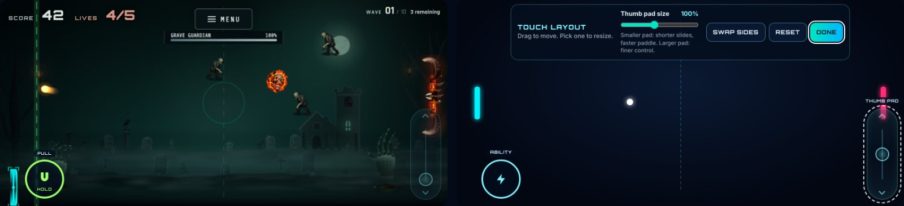</p>
<p align="center"><sub>Left: the thumb pad in a match (its knob shows where your paddle is). Right: Settings &gt; Controls &gt; Touch layout.</sub></p>

## Settings

**Settings** opens from the main menu, the pause menu, the match setup dialog
and the Custom screen, and saves as you change it.

| Tab | What's in it |
|---|---|
| **Profile** | Your name, level and match stats, with played, win rate and time for each mode. |
| **Gameplay** | Computer skill, points to win, power-ups on the court, instant replays (Auto / Offer / Off), AI trash talk, pause when you switch away. |
| **Paddles** | A paddle design for each mode, for your paddle and your opponent's, with live previews. |
| **Controls** | Paddle speed, touch layout (thumb pad and ability button position and size, on phones), key rebinding for both players, controller and phone vibration. |
| **Display** | Visual quality, effect switches, Noir theme, screen shake, impact flash, particles, scoreboard size, FPS counter. |
| **Audio** | Master, music, sound effects and voice volumes; sound, music and voice switches; mute in the background. |
| **Accessibility** | Reduce motion, high-visibility ball, menu text size. |

<table>
<tr>
<td width="33%">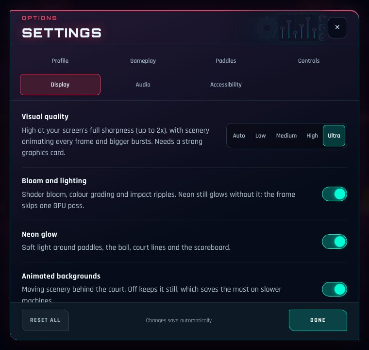<br/><sub><b>Display</b></sub></td>
<td width="33%">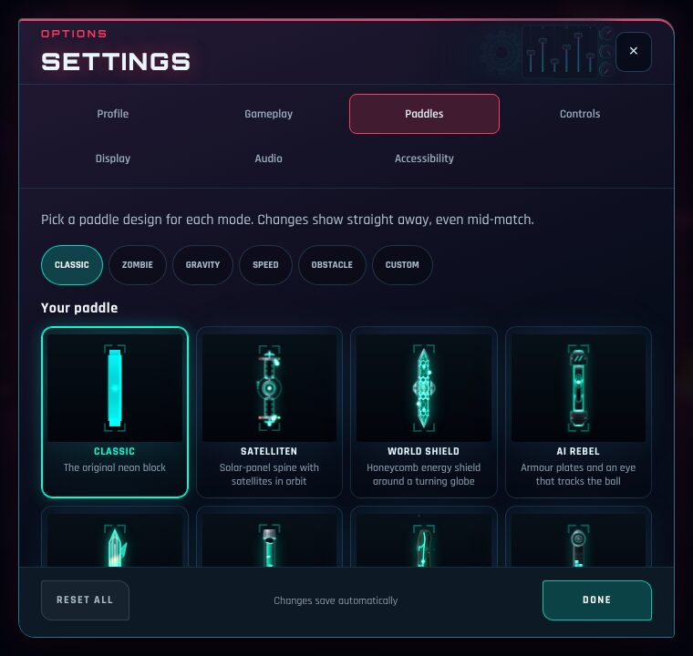<br/><sub><b>Paddles</b></sub></td>
<td width="33%">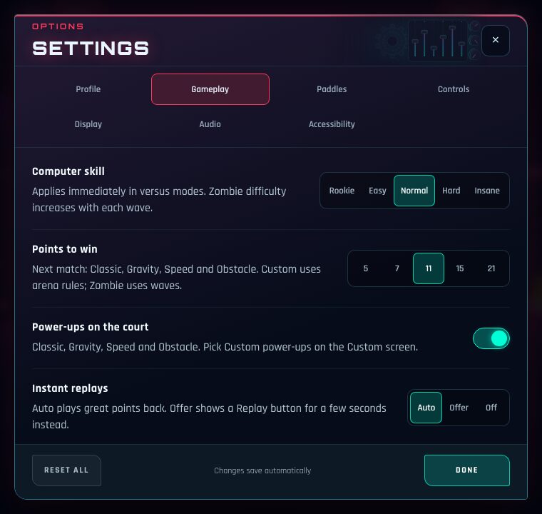<br/><sub><b>Gameplay</b></sub></td>
</tr>
</table>

**Visual quality** is Auto, Low, Medium, High or Ultra. Auto picks the best
level the device can hold at its refresh rate and keeps adjusting during play;
the others are fixed. High and Ultra keep full 4K scenery. Under it are
switches for **Bloom and lighting**, **Neon glow** and **Animated
backgrounds**.

**Noir theme** turns the whole game, menus included, into a black-and-white
film with grain, flicker and scanlines (Reduce motion disables the flicker).

<p align="center">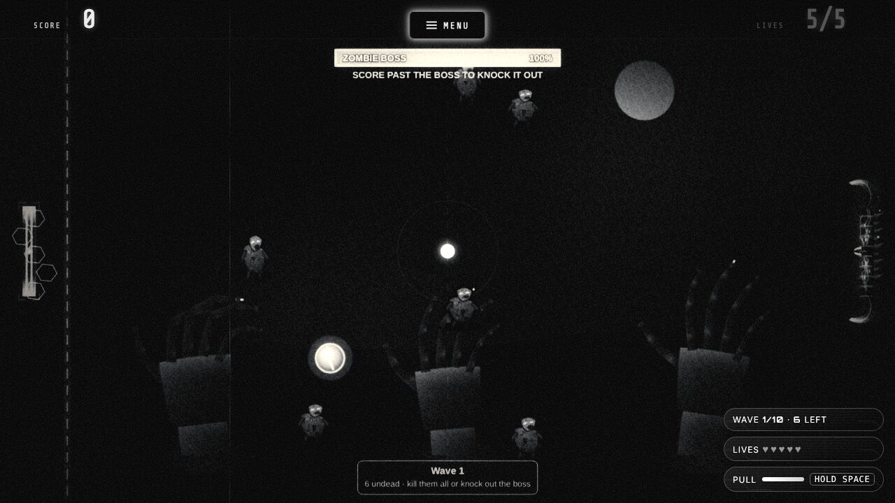</p>

**Paddle designs** (each animates and reacts to hits):

| Design | Look |
|---|---|
| Classic | The original neon block |
| Satelliten | Solar-panel spine with satellites in orbit |
| World Shield | Honeycomb energy shield around a turning globe |
| AI Rebel | Armour plates and an eye that tracks the ball |
| Prizma | Faceted crystal with a sweeping spectrum |
| Riptide | A glass tube of liquid that sloshes as you move |
| Magma | Cracked basalt with lava veins that flare on every hit |
| Bassline | Speaker stack with level meters that dance to the music |

The **pause menu** has Resume, Restart match, Settings, Audio, Help and Quit to
menu.

<p align="center">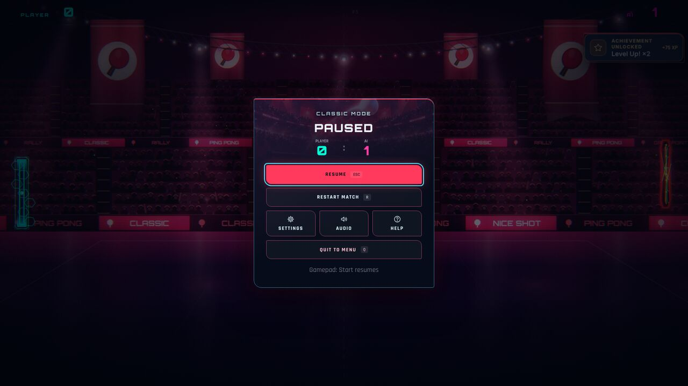</p>

## Progress and achievements

Every match earns XP towards your level, shown on the results card and in
the menu's Player Progress panel. There are **51 achievements**, from First
Blood and Rally Master to Wave Runner, Gravity Defier, Mode Conqueror and
Centurion, each with a progress bar where it counts up and a joke when it
unlocks. The collection opens from the menu (or **Ctrl+Shift+A**) with search
and All / Unlocked / In progress filters; recent unlocks show on the menu.
Progress is saved in the browser on each device.

<table>
<tr>
<td width="50%">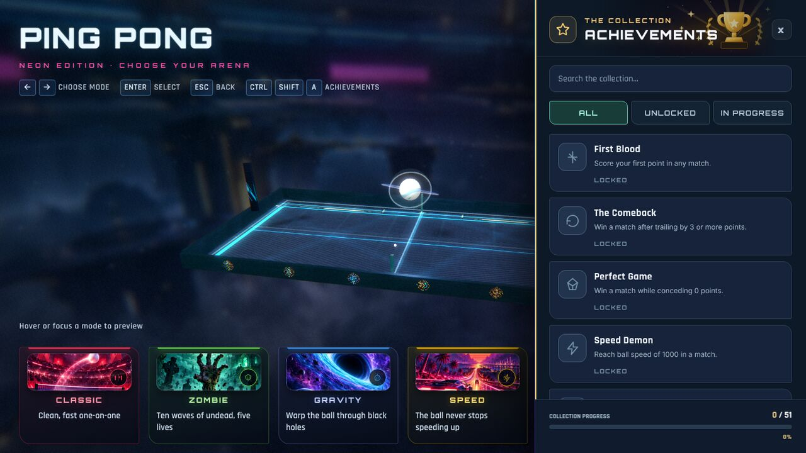<br/><sub><b>Achievements</b>: 51 to collect</sub></td>
<td width="50%">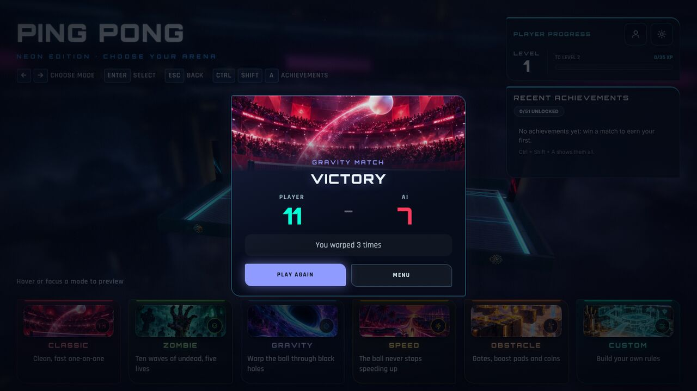<br/><sub><b>Results card</b>: score, highlights, Play again</sub></td>
</tr>
</table>

## How it plays: the physics

Ball physics live in [`physics/physics.cpp`](physics/physics.cpp), compiled to a
3.5 KB WebAssembly module embedded in the game (so it also loads from
`file://`). A JavaScript port of the same model takes over only if WebAssembly
is unavailable.

- **Spin you can see.** Moving the paddle as you hit brushes spin onto the ball
  (Magnus effect), so it curves in flight. Spin decays over time and kicks the
  ball forward off the side rails. Arcs orbit the ball at the speed and in the
  direction of its spin, so you can see a curving shot coming.
- **English.** Some of the paddle's motion carries into the return.
- **Aim by contact point.** Centre hits stay flat; edge hits angle sharply.
- **No tunnelling.** Paddle collisions are swept along the ball's path, so even
  the fastest balls can't pass through a paddle between frames.
- **Rallies build** gradually: a live rally counter grows and warms in colour,
  with a callout every 5 hits; returning the ball off the very tip of the
  paddle earns a **CLUTCH!** slow-mo beat. The ball's trail heats up with speed.
- **Impact feel:** hit-stop, paddle recoil and squash, ball squash/stretch,
  trauma-style screen shake with a directional camera kick, and shader
  shockwaves, all scaled by how hard the ball was hit.
- **Sound you can feel:** layered impacts (click, pitched body, low thump on
  hard hits) that get louder and brighter with speed, panned to where they
  happen; the two paddles are pitched differently: ping… pong.
- **Every point lands:** goals get a shockwave, flash and camera punch, then a
  short telegraphed serve (countdown ring + direction chevrons) towards the
  player who conceded. Great points get an instant replay.
- **Mouse and touch control have real momentum**, so pointer players can put
  spin and english on the ball too, and paddles are interpolated between
  physics steps so they stay smooth on 144/165 Hz screens.

## Graphics and performance

- **Game:** the playfield is drawn with Canvas 2D, then run through a WebGL
  post-process ([`game/js/render/post-fx.js`](game/js/render/post-fx.js)):
  two-level bloom, a lens-dirt texture lit by the bloom, impact shockwave
  ripples, chromatic punch on hard hits, per-mode colour grading, vignette,
  scanlines, film grain and the Noir grade.
- **Scenery:** each arena has hand-built, animated art: Classic's cloth and
  crowd, Zombie's fog, lanterns and articulated hands, Gravity's nebula
  surfaces and accretion flow, Speed's synthwave road, Obstacle's sky shader
  and waterfalls. Artwork ships at up to 3840 × 2160 and High/Ultra keep full
  4K scenery ([docs/4k-rendering.md](docs/4k-rendering.md)).
- **Menu:** a Three.js scene with a court shader, procedural court texture,
  animated sky and its own bloom pass
  ([`game/js/menu/menu-bloom.js`](game/js/menu/menu-bloom.js)).
- **Adaptive quality:** `PerfGovernor` learns the display refresh rate and, if
  frames are missed in Auto, steps down glow, particles, render resolution,
  background animation rate and post-fx quality, then steps back up when
  there's headroom. Scenery is cached and redrawn on its own cadence so the
  gameplay frame stays cheap.
- **F2** shows FPS, detected refresh rate, quality tier, render scale, shaders
  and physics backend.

**Getting 120 FPS on a laptop:**

1. Set the laptop screen to its highest refresh rate (Windows: *Settings →
   System → Display → Advanced display → Choose a refresh rate*).
2. Plug the laptop in: on battery, Windows and the GPU often cap frame rates.
3. Launch with `Play Ping Pong.bat`: it starts the browser with the dedicated
   GPU preferred (`--force-high-performance-gpu`) and GPU rasterisation on.
4. Press **F2** in a match to check the frame rate and quality tier.

On a 60 Hz screen, `"Play Ping Pong.bat" uncapped` from a command prompt
unlocks frame rates above 60 (expect some screen tearing).

## Run it locally

**Windows:** double-click **`Play Ping Pong.bat`**. Nothing to install: it
starts a tiny local web server with PowerShell and opens the game in Chrome or
Edge. Keep the small console window open while you play; close it to stop.

**Any system:** serve the `game/` folder with any static web server, then open
it in a browser:

```
python -m http.server 8080 --directory game
# open http://127.0.0.1:8080/
```

**Let testers anywhere play your copy:** double-click
**`Share Online (PC + Mobile).bat`**. After a few seconds it shows a public
link like `https://some-random-words.trycloudflare.com/` (also copied to the
clipboard) and a QR code for phones.

- It uses a free Cloudflare quick tunnel: no account, router or firewall
  setup. The first run downloads `cloudflared.exe` (about 60 MB) into
  `tools\bin`.
- Only the `game/` folder is shared, read-only. The link is random, changes on
  every run, and stops working when you close the window.
- The game is about 50 MB, mostly music that streams as it plays, sent from
  your PC, so your upload speed decides how fast testers' first load is.
- The QR code image comes from api.qrserver.com.

## Project layout

```
index.html                Redirects the GitHub Pages site to game/ (keeps ?join= codes)
Play Ping Pong.bat        Double-click to play (Windows)
Share Online (PC + Mobile).bat   Public link + QR code so remote testers can play
game/                     Everything the browser loads
  index.html                Intro / boot screen
  play.html                 Menu + game
  manifest.webmanifest      Home Screen app manifest (icons in assets/icons)
  ball-studio.html          Ball Studio skin editor
  css/                      Stylesheets (art direction, mobile fit, bundled fonts)
  js/
    core/                   Game class, globals + quality governor, art direction, boot
    entities/               Ball, paddles + paddle designs, power-ups, gravity wells
    modes/                  Zombie (boss, pull, power-ups, sprites), Gravity wormhole,
                            Speed challenge, Obstacle course/arcade/dice, Forge editor
                            and gadgets, mode abilities, custom backgrounds
    render/                 Scene compositor, per-mode art, post-fx, shaders, 4K resolution
    ai/                     AI opponent and trash-talk lines
    net/                    Online play (PeerJS/WebRTC), backup signalling relays, TURN config
    menu/                   Three.js menu, menu bloom, Custom screen, mode art
    physics/                WebAssembly physics bridge (+ background simulation worker)
    audio/  fx/  systems/  ui/  app/
    vendor/                 three.js, anime.js, PeerJS (no CDN needed)
  assets/                   audio/, fonts/, images/
physics/                  C++ source for the physics engine + build scripts
tests/                    Node and Playwright tests
tools/serve.ps1           Zero-dependency local web server used by the .bat files
tools/share.ps1           Cloudflare quick tunnel for "Share Online"
tools/build-offline-assets.js  Regenerates game/offline-assets.json (rerun after adding/removing files in game/)
android/                  Play Store (Trusted Web Activity) config for Bubblewrap
docs/                     Design notes; docs/images holds the screenshots in this README
```

## Tests

Unit-style tests run with plain Node, e.g. `node tests/match-flow.test.js`.
Files ending in `.browser.js` drive the real game with Playwright: serve
`game/` on `http://127.0.0.1:8080` (or set `GAME_TEST_URL`) and run them with
Node, e.g. `node tests/all-modes-4k.browser.js`.

## Rebuilding the physics engine

Only needed if you change `physics/physics.cpp`. You need clang with the
WebAssembly target (LLVM 14+; on Windows `winget install LLVM.LLVM`):

```
physics\build.ps1        (Windows)
physics/build.sh         (macOS / Linux)
```

This regenerates `game/js/physics/physics-binary.js`. See
[`physics/README.md`](physics/README.md) for details.

## Further docs

- [Mobile app and Play Store launch](docs/mobile-app.md)
- [Online play and TURN relays](docs/online-play.md)
- [Art direction](docs/art-direction.md)
- [4K artwork and rendering](docs/4k-rendering.md)
- [Background rendering](docs/background-rendering.md)
- [Gameplay feel](docs/gameplay-feel.md)
- [Obstacle sky scene](docs/obstacle-sky.md)
- [Zombie performance](docs/zombie-performance.md) · [Zombie sprites](docs/zombie-sprites.md)
